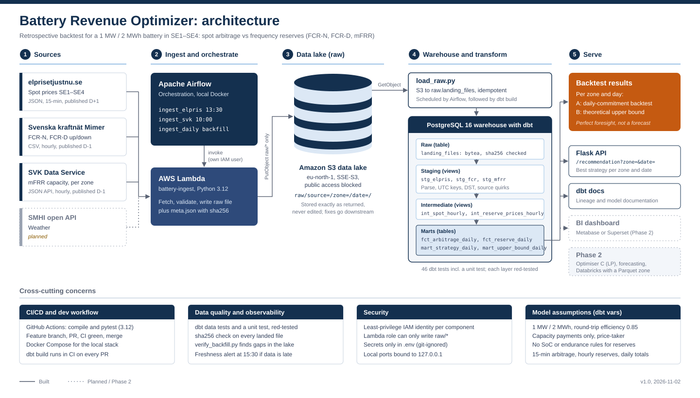
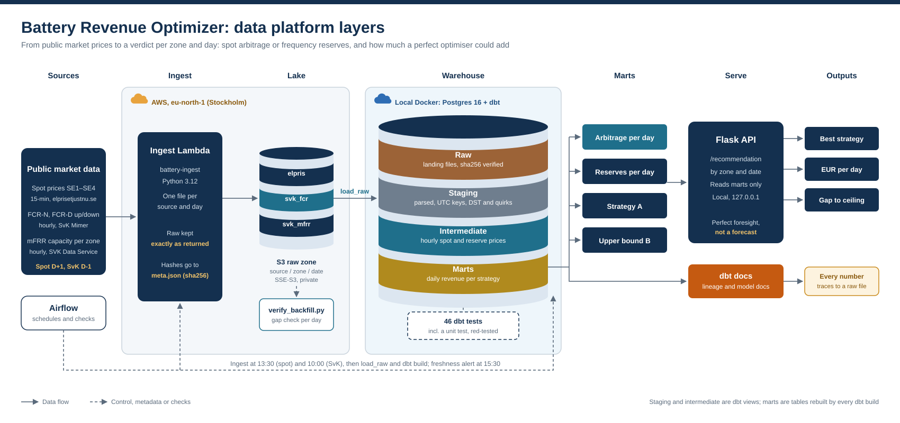

# Battery Revenue Optimizer

A data platform that backtests, for every Swedish bidding zone and every day, whether a 1 MW / 2 MWh battery would have earned more from spot-price arbitrage or from frequency reserve markets (FCR-N, FCR-D up/down, mFRR up/down). It also shows how much a perfect optimiser could add on top. Python ingestion on AWS Lambda lands raw market data in S3, Airflow orchestrates, dbt models it in Postgres, and a Flask API serves the result.

[](docs/images/architecture.svg)

## The business question

A battery owner in Sweden can earn money in two ways:

1. **Energy arbitrage.** Charge when spot prices are low, discharge when they are high. Paid per MWh moved, limited by the state of charge and round-trip losses.
2. **Balancing services.** Stand by for Svenska kraftnät and get a capacity payment in EUR per MW per hour. "Up" means the battery discharges when the grid is short of power; "down" means it charges when the grid has a surplus.

The platform answers three questions per zone and day:

- Which single strategy would have earned the most?
- How much did it earn, in EUR?
- How much more could a perfect optimiser have earned by mixing strategies hour by hour?

This is a **retrospective backtest with perfect foresight**, not a forecast. Every simplification is listed under [Limitations](#limitations).

## How data flows

[](docs/images/platform_layers.svg)

1. **Ingest.** Airflow invokes the `battery-ingest` Lambda: spot prices at 13:30 (published for tomorrow) and SvK reserve data at 10:00 (published for yesterday). The Lambda writes each response to S3 exactly as returned, next to a `meta.json` with sha256 hashes of the file and of its records.
2. **Lake.** One file per source, zone and delivery date under `raw/source=<src>/zone=<zone>/date=<date>/`. Re-running a day overwrites the same key, so ingestion is idempotent.
3. **Load.** `load_raw.py` copies raw files into `raw.landing_files` in Postgres as bytes, with an idempotent upsert, and verifies each sha256 after landing.
4. **Transform.** dbt parses the raw bytes in staging views, aligns spot and reserve prices to hourly grain in intermediate views, and computes daily revenue per strategy in mart tables.
5. **Serve.** A Flask API returns the best strategy, its revenue and the gap to the ceiling for a zone and date. dbt docs show lineage from every mart column back to the raw landing table.
6. **Check.** dbt tests run on every build. `verify_backfill.py` lists missing days in the lake. A freshness alert fires at 15:30 if today's data has not arrived.

## Tech stack

| Area | Tools |
| --- | --- |
| Cloud | AWS eu-north-1 (Stockholm): S3, Lambda, IAM |
| Ingestion | Python 3.12 on Lambda, requests, boto3 |
| Orchestration | Apache Airflow in Docker Compose |
| Warehouse | PostgreSQL 16 in Docker |
| Transform | dbt-core 1.12 with dbt-postgres |
| Serving | Flask API, dbt docs |
| Engineering | pytest, GitHub Actions CI, Docker Compose, branch and pull request workflow |

## Data sources

| Source | Data | Format | Grain | Published |
| --- | --- | --- | --- | --- |
| elprisetjustnu.se | Spot prices SE1–SE4 | JSON | 15 minutes | Day ahead (D+1) |
| SvK Mimer | FCR-N, FCR-D up, FCR-D down | CSV | Hourly, one Swedish price per product | Day after (D-1) |
| SVK Data Service | mFRR capacity, up and down | JSON API | Hourly, per zone | Day after (D-1) |

Source quirks are handled and tested in dbt staging, never by editing raw files:

- **FCR CSV:** semicolon separator, decimal commas, a `Summa` totals row, UTF-8 BOM, CRLF line endings, trailing separators, extra DK2 columns, and local time without an offset (02:00 appears twice on the October DST day).
- **mFRR JSON:** UTC timestamps without an offset, so they are declared UTC explicitly and cross-checked against the Swedish-time column. The response envelope's `total` and `limit` feed a truncation test.
- **Spot JSON:** prices in EUR per kWh (converted to EUR per MWh), negative prices, and 92 or 100 quarter-hours on DST days.

## What is in the platform

### dbt models

| Layer | Models | Materialisation | Holds |
| --- | --- | --- | --- |
| Staging | `stg_elpris`, `stg_fcr`, `stg_mfrr` | Views | Parsed rows with a UTC timestamp key, one row per zone, time and product |
| Intermediate | `int_spot_hourly`, `int_reserve_prices_hourly` | Views | Prices aligned to the hour for every zone |
| Marts | `fct_arbitrage_daily`, `fct_reserve_daily` | Tables | Daily revenue from arbitrage and from each reserve product |
| Marts | `mart_strategy_daily` | Table | Strategy A: the best single strategy per zone and day |
| Marts | `mart_upper_bound_daily` | Table | Strategy B: the theoretical ceiling, best product per quarter-hour |

Battery assumptions are dbt variables, not hidden constants: `battery_power_mw: 1`, `battery_energy_mwh: 2`, `round_trip_efficiency: 0.85` (NREL ATB; EIA reports about 0.82 for the US fleet).

### Two strategies, labelled honestly

- **A: daily-commitment backtest (perfect foresight).** The battery commits to one strategy for the whole day. This is the headline number.
- **B: theoretical upper bound.** The best product in every quarter-hour, ignoring state of charge. No real battery can earn this; it marks how much room an optimiser has.

Neither is "expected revenue".

### Data quality

| Check | Where | What it catches |
| --- | --- | --- |
| sha256 after landing | Loader | Corrupted or partial copies between S3 and Postgres |
| Lake gap check (`verify_backfill.py`) | S3 | Days a source never delivered or a run never wrote |
| Freshness alert at 15:30 | Airflow | Today's data has not arrived |
| 46 dbt tests | Staging, intermediate, marts | Duplicate keys, nulls, unexpected products and zones, truncated API responses, wrong row counts per day |
| dbt unit test | Marts | Arbitrage logic against a hand-calculated day |

Every check has been seen to fail at least once (a deliberately broken test, a reintroduced bug, or a non-UTC database session) before it was trusted.

### Time zones

`ts_utc` is the key everywhere; local time is derived in dbt. Every conversion states UTC explicitly (`::timestamp at time zone 'UTC'` for offset-less text and three-argument `date_trunc(..., 'UTC')`). Timestamp logic is tested in a session set to `Europe/Stockholm`, so a forgotten conversion shows up as a failing test rather than a silently shifted hour.

## Results

Backtest over 99 days, 2026-07-01 to 2026-10-07, in EUR per day (averages):

| Zone | Arbitrage | Best reserve product | Strategy A (best per day) | Strategy B ceiling | Room for an optimiser |
| --- | --- | --- | --- | --- | --- |
| SE1 | 57.7 | mFRR down, 515.6 | 593.0 | 772.3 | +30 % |
| SE2 | 61.0 | FCR-N, 406.2 | 492.0 | 737.8 | +50 % |
| SE3 | 128.3 | FCR-N, 406.2 (best on 91 of 99 days) | 453.9 | 949.7 | +109 % |
| SE4 | 210.2 | mFRR up, 618.9 | 719.6 | 1,432.1 | +99 % |

What it says: reserve capacity payments beat pure arbitrage in every zone over this period, often by a factor of three or more. The ceiling is widest in SE3 and SE4, so that is where an optimiser would add the most.

## Engineering practice

- **Raw is immutable.** Files are stored exactly as the source returned them; every fix lives in dbt, where it is versioned and tested.
- **Idempotent everywhere.** Deterministic S3 keys, upserts in the loader, and dbt models rebuilt from raw, so any day can be re-run safely.
- **Tested.** pytest for pure Python functions (key parsing, request building), dbt data tests for data properties, a dbt unit test for logic with a known answer.
- **CI on every pull request.** GitHub Actions on pinned Ubuntu with Python 3.12 compiles the code, runs pytest and runs `dbt build`.
- **Small pull requests.** One branch per component, a PR with what, why, evidence and what is not covered, CI green before merge.

## Security

- **Least privilege.** The Lambda role can only write `raw/*`. The local Airflow identity can only invoke the Lambda and read `raw/*`. No code runs with administrator rights.
- **Secrets stay local.** Credentials live in a git-ignored `.env`. Staged files are scanned before each push.
- **Private by default.** The S3 bucket blocks public access and is encrypted with SSE-S3. Docker ports are bound to `127.0.0.1`.
- **No identifiers in the repo.** Account IDs and access key IDs are never committed.

## Cost

S3 and Lambda run on the AWS Free plan. Airflow, Postgres and Flask run locally in Docker Compose, so nothing bills while the laptop is off. Managed Airflow (MWAA) is the production target only, because it bills by the hour even when idle.

## Repository layout

```
lambda_function.py   Lambda entry point
ingest.py            spot price ingestion
ingest_svk.py        SvK FCR and mFRR ingestion
load_raw.py          S3 raw zone to raw.landing_files
verify_backfill.py   gap check over the lake
dags/                Airflow DAGs
battery_dbt/         dbt project: staging, intermediate, marts, tests
api/                 Flask API
sql/                 warehouse setup (landing table)
tests/               pytest suite
docs/images/         architecture diagrams
docker-compose.yml   local stack: Airflow, Postgres warehouse
```

## Running it

Prerequisites: an AWS account, Docker Desktop, and Python 3.12 or later.

1. Create the S3 bucket, the `battery-ingest` Lambda and the two IAM identities (Lambda role, Airflow invoker) in eu-north-1.
2. Copy `.env.example` to `.env` and fill in the warehouse and AWS settings.
3. Start the stack with `docker compose up -d` and create the landing table from `sql/`.
4. In Airflow, unpause `ingest_elpris` and `ingest_svk`. Keep `ingest_daily` paused; it is for backfills only.
5. Load and transform: `python load_raw.py <start> <end>`, then `dbt build` inside `battery_dbt/`.
6. Query the API: `GET /recommendation?zone=SE3&date=2026-09-15`.

## Design decisions

- **Airflow over EventBridge Scheduler.** EventBridge is simpler for two daily jobs, but Airflow makes backfills, reruns and dependencies visible.
- **dbt on Postgres over DuckDB.** A real warehouse with schemas, roles and concurrent readers for the API; DuckDB stays an option for a local Parquet zone later.
- **Raw kept as bytes in the warehouse.** Landing raw files unparsed means a parsing bug is fixed in dbt and replayed, never re-fetched.
- **Mixed grain.** Arbitrage runs on 15-minute prices, reserves on hourly prices; the strategies meet as daily totals.
- **Two strategies instead of one number.** A realistic floor (A) and an honest ceiling (B) bracket what an optimiser could earn.

## Limitations

- Capacity payments only; activation energy payments are not included.
- No state-of-charge or endurance rules for reserves, and no stacking of several products in one hour.
- The battery is a price-taker: its bids never move the price.
- FCR price formation is taken from published results and not independently verified.
- Perfect foresight: the backtest knows every price of the day in advance.

## Roadmap (Phase 2)

- Optimiser C as a linear programme, starting with SE3 and SE4 where the gap to the ceiling is widest
- Verify SvK reserve rules (endurance, state of charge, stacking) and FCR price formation
- Price forecasting model on a feature table, with weather data from the SMHI open API
- Databricks version of the transformations with a Parquet processed zone
- BI dashboard (Metabase or Superset)
- Managed Airflow, Terraform for the AWS setup
- Migrate FCR from Mimer to SVK Data Service before Mimer is retired
