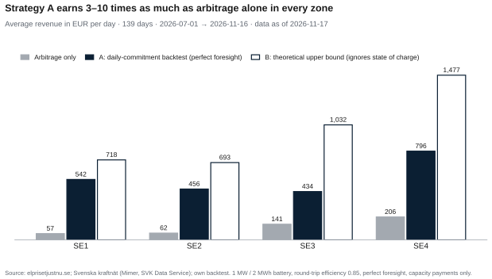
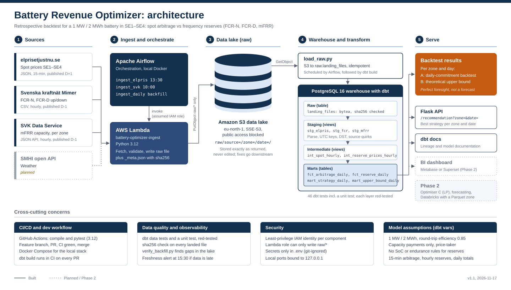
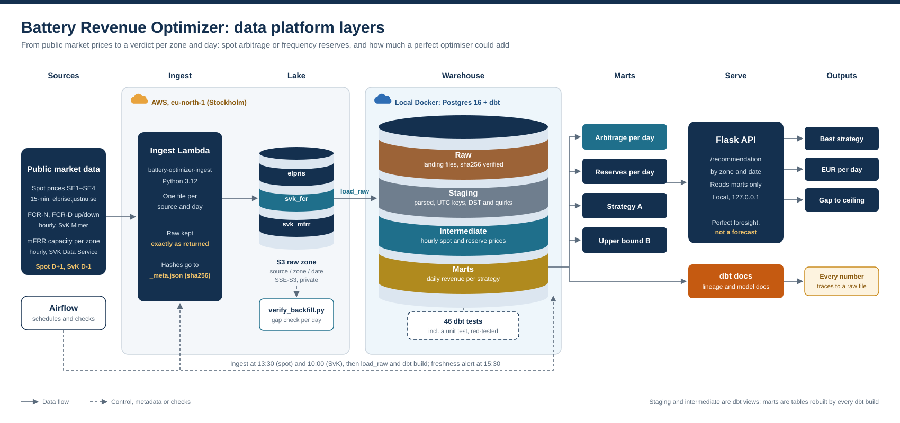

# Battery Revenue Optimizer

A data platform that backtests, for every Swedish bidding zone and every day, whether a 1 MW / 2 MWh battery would have earned more from spot-price arbitrage or from frequency reserve markets (FCR-N, FCR-D up/down, mFRR up/down). Python on AWS Lambda lands raw market data in S3, Airflow orchestrates, dbt models it in Postgres, and a Flask API serves the result.

## TL;DR

<!-- results:tldr:start -->
- **Reserves beat arbitrage in every zone.** Committing to one strategy per day (A), a 1 MW / 2 MWh battery earned 434–796 EUR per day depending on zone, 3–10 times as much as spot arbitrage alone (139 days, 2026-07-01 → 2026-11-16). → [Results](#results)
- **One product leads in each zone.** Most often mFRR down in SE1; FCR-N in SE2 and SE3; mFRR up in SE4. Arbitrage was the best choice on at most 3 of 139 days in any zone. → [Which strategy wins](docs/results.md#which-strategy-wins)
- **The ceiling is not a forecast.** B mixes products quarter by quarter and ignores state of charge. It is 32–138 % above A, widest in SE3. No real battery can earn it; it marks the room for an optimiser (Phase 2). → [Definitions](docs/results.md#definitions)
- **Reproducible from raw data.** The data lake was rebuilt from scratch in a new AWS account and the results for the first 99 days came out identical; one script generates every table and chart from the warehouse. → [How to reproduce](docs/results.md#how-to-reproduce)
- **Serverless and keyless.** Lambda and S3 managed by Terraform, sign-in through SSO with no long-lived keys, estimated at well under USD 1 per month. → [Security](#security), [Cost](#cost)
<!-- results:tldr:end -->

[](docs/images/results_a_vs_b.svg)

*Average EUR per day per zone: arbitrage only, the daily-commitment backtest A and the theoretical ceiling B.*

## The business question

A battery owner in Sweden can earn money in two ways:

1. **Energy arbitrage.** Charge when spot prices are low, discharge when they are high. Paid per MWh moved, limited by the state of charge and round-trip losses.
2. **Balancing services.** Stand by for Svenska kraftnät and get a capacity payment in EUR per MW per hour. "Up" means the battery discharges when the grid is short of power; "down" means it charges when the grid has a surplus.

The platform answers three questions per zone and day:

- Which single strategy would have earned the most?
- How much did it earn, in EUR?
- What is the theoretical ceiling if strategies could be mixed quarter by quarter, ignoring state of charge?

This is a **retrospective backtest with perfect foresight**, not a forecast. Every simplification is listed under [Limitations](#limitations).

## Results

<!-- results:window:start -->
**139 days, 2026-07-01 → 2026-11-16, data as of 2026-11-17.** Averages in EUR per day for a 1 MW / 2 MWh battery.
<!-- results:window:end -->

<!-- results:summary:start -->
| Zone | Arbitrage only | Best reserve product (days best) | A: daily-commitment backtest (perfect foresight) | B: theoretical upper bound | Ceiling above A (B / A − 1) |
| --- | --- | --- | --- | --- | --- |
| SE1 | 56.7 | mFRR down, 458.7 (82 of 139) | 542.4 | 717.6 | +32 % |
| SE2 | 61.5 | FCR-N, 395.3 (108 of 139) | 456.4 | 693.3 | +52 % |
| SE3 | 141.2 | FCR-N, 395.3 (128 of 139) | 434.0 | 1,031.6 | +138 % |
| SE4 | 206.2 | mFRR up, 722.5 (95 of 139) | 796.3 | 1,476.8 | +85 % |
<!-- results:summary:end -->

<!-- results:coverage:start -->
SE1 mFRR up: 3,245 of 3,337 hours published (10 days with gaps). Unpublished hours count as 0 revenue.
<!-- results:coverage:end -->

[](docs/images/results_winners.svg)

*On how many days each product was the best single choice, per zone.*

[](docs/images/results_monthly.svg)

*A (solid) against the ceiling B (dashed), month by month per zone; the last month can be partial.*

Reserve capacity payments beat spot arbitrage in every zone: strategy A earns 3 to 10 times as much as arbitrage alone. The ranking is stable: each zone's best reserve product and the order of zones (SE4, SE1, SE2, SE3) are the same as in the first 99 days to 2026-10-07, while A fell 4–9 % in SE1–SE3 and rose 11 % in SE4. The gap between A and the ceiling widened most in SE3 as daily spot spreads grew (76 → 180 EUR/MWh on average from July to the first half of November); B ignores state of charge, so it widens with volatility by construction, and how much a real, state-of-charge-constrained optimiser could capture is the Phase 2 question (optimiser C). All figures assume perfect foresight and count capacity payments only; they are backtest results, not expected revenue.

Method, assumptions, caveats and monthly figures: [docs/results.md](docs/results.md).

## How data flows

[](docs/images/architecture.svg)

[](docs/images/platform_layers.svg)

1. **Ingest.** Airflow invokes the `battery-optimizer-ingest` Lambda: spot prices at 13:30 (published for tomorrow) and SvK reserve data at 10:00 (published for yesterday). The Lambda writes each response to S3 exactly as returned, next to a `_meta.json` with sha256 hashes of the file and of its records.
2. **Lake.** One file per source, zone and delivery date under `raw/source=<src>/zone=<zone>/date=<date>/`. Re-running a day overwrites the same key, so ingestion is idempotent; S3 versioning keeps the previous bytes, so a source revision never destroys what was received before.
3. **Load.** `load_raw.py` copies raw files into `raw.landing_files` in Postgres as bytes, with an idempotent upsert, and verifies each sha256 after landing.
4. **Transform.** dbt parses the raw bytes in staging views, aligns spot and reserve prices to hourly grain in intermediate views, and computes daily revenue per strategy in mart tables.
5. **Serve.** A Flask API returns the best strategy, its revenue and the gap to the ceiling for a zone and date. dbt docs show lineage from every mart column back to the raw landing table.
6. **Check.** dbt tests run on every build. `verify_backfill.py` lists missing days in the lake. A freshness alert fires at 15:30 if today's data has not arrived.

## Tech stack

| Area | Tools |
| --- | --- |
| Cloud | AWS eu-north-1 (Stockholm): S3, Lambda, IAM, CloudWatch Logs; sign-in through IAM Identity Center (SSO) |
| Infrastructure as code | Terraform 1.11 (AWS provider 6.71), state in its own S3 bucket |
| Ingestion | Python 3.12 on Lambda, requests, boto3 |
| Orchestration | Apache Airflow in Docker Compose |
| Warehouse | PostgreSQL 16 in Docker |
| Transform | dbt-core 1.12 with dbt-postgres |
| Serving | Flask API, dbt docs |
| Engineering | pytest, GitHub Actions CI, Docker Compose, branch and pull request workflow |

## Data sources

| Source | Data | Format | Grain | Published |
| --- | --- | --- | --- | --- |
| elprisetjustnu.se | Spot prices SE1–SE4 | JSON | 15 minutes | Day ahead (D+1) |
| SvK Mimer | FCR-N, FCR-D up, FCR-D down | CSV | Hourly, one Swedish price per product | Day after (D-1) |
| SVK Data Service | mFRR capacity, up and down | JSON API | Hourly, per zone | Day after (D-1) |

Source quirks are handled and tested in dbt staging, never by editing raw files:

- **FCR CSV:** semicolon separator, decimal commas, a `Summa` totals row, UTF-8 BOM, CRLF line endings, trailing separators, extra DK2 columns, and local time without an offset. On the October DST day the repeated 02:00 hour is labelled `02:01:00`; staging flags it (`is_repeated_hour`) and normalizes the label. The spring DST day is not yet covered by real data.
- **mFRR JSON:** UTC timestamps without an offset, so they are declared UTC explicitly and cross-checked against the Swedish-time column. The response envelope's `total` and `limit` feed a truncation test. Some hours are not published at all (SE1 up from 2026-10-16); a warn-level test lists them and they count as 0 revenue.
- **Spot JSON:** prices in EUR per kWh (converted to EUR per MWh), negative prices, and 92 or 100 quarter-hours on DST days.

## What is in the platform

### dbt models

| Layer | Models | Materialisation | Holds |
| --- | --- | --- | --- |
| Staging | `stg_elpris`, `stg_fcr`, `stg_mfrr` | Views | Parsed rows with a UTC timestamp key, one row per zone, time and product |
| Intermediate | `int_spot_hourly`, `int_reserve_prices_hourly` | Views | Prices aligned to the hour for every zone |
| Marts | `fct_arbitrage_daily`, `fct_reserve_daily` | Tables | Daily revenue from arbitrage and from each reserve product |
| Marts | `mart_strategy_daily` | Table | Strategy A: the best single strategy per zone and day |
| Marts | `mart_upper_bound_daily` | Table | Strategy B: the theoretical ceiling, best product per quarter-hour |

Battery assumptions are dbt variables, not hidden constants: `battery_power_mw: 1`, `battery_energy_mwh: 2`, `round_trip_efficiency: 0.85` (NREL ATB; EIA reports about 0.82 for the US fleet).

### Two strategies, labelled honestly

- **A: daily-commitment backtest (perfect foresight).** The battery commits to one strategy for the whole day. This is the headline number.
- **B: theoretical upper bound.** The best product in every quarter-hour, ignoring state of charge. No real battery can earn this; it marks how much room an optimiser has.

Neither is "expected revenue".

### Data quality

| Check | Where | What it catches |
| --- | --- | --- |
| sha256 after landing | Loader | Corrupted or partial copies between S3 and Postgres |
| Lake gap check (`verify_backfill.py`) | S3 | Days a source never delivered or a run never wrote |
| Freshness alert at 15:30 | Airflow | Today's data has not arrived |
| 50 dbt data tests | Staging, intermediate, marts | Duplicate keys, nulls, unexpected products and zones, truncated API responses, wrong row counts per day (missing mFRR hours: warning) |
| 2 dbt unit tests | Staging, marts | FCR parsing of a hand-made 25-hour DST day; arbitrage logic against a hand-calculated day |

Every check has been seen to fail at least once (a deliberately broken test, a reintroduced bug, or a non-UTC database session) before it was trusted.

### Time zones

`ts_utc` is the key everywhere; local time is derived in dbt. Every conversion states UTC explicitly (`::timestamp at time zone 'UTC'` for offset-less text and three-argument `date_trunc(..., 'UTC')`). Timestamp logic is tested in a session set to `Europe/Stockholm`, so a forgotten conversion shows up as a failing test rather than a silently shifted hour.

## Engineering practice

- **Raw is immutable.** Files are stored exactly as the source returned them; every fix lives in dbt, where it is versioned and tested.
- **Idempotent everywhere.** Deterministic S3 keys, upserts in the loader, and dbt models rebuilt from raw, so any day can be re-run safely.
- **Tested.** pytest for pure Python functions (key parsing, request building), dbt data tests for data properties, dbt unit tests for logic with a known answer.
- **CI on every pull request.** GitHub Actions on pinned Ubuntu with Python 3.12 compiles the code, runs pytest and runs `dbt build`.
- **Small pull requests.** One branch per component, a PR with what, why, evidence and what is not covered, CI green before merge.

## Security

- **No long-lived AWS keys.** People sign in through IAM Identity Center (SSO). Airflow and the local scripts assume the IAM role `battery-optimizer-airflow` from that session through an AWS profile; the role's trust policy accepts only that SSO permission set. The trade-off: scheduled runs need a live SSO session that day; the freshness check catches a missed day and `ingest_daily` backfills it. In production, the same policy would be attached to the compute running Airflow (workload identity), so no human session and no keys are involved.
- **Least privilege.** The Lambda role can only write `raw/*` and its own log stream. The Airflow role can only invoke the Lambda and list and read `raw/*`. No code runs with administrator rights.
- **Secrets stay local.** Passwords live in a git-ignored `.env`. Staged files are scanned before each push.
- **Private by default.** Both S3 buckets block public access, disable ACLs, are encrypted with SSE-S3 and reject requests that are not over TLS. Docker ports are bound to `127.0.0.1`.
- **No identifiers in the repo.** Account IDs, ARNs containing them and SSO URLs are never committed; Terraform reads the account ID at plan time.

## Cost

**Estimate, not a measured bill: well under USD 1 per month.** Everything in AWS is billed on demand only (S3, Lambda, CloudWatch Logs); nothing bills by the hour while idle. The data is small (a few KB-sized files per day plus their metadata) and the Lambda runs about 10 short invocations a day at 256 MB. Airflow, Postgres and Flask run locally in Docker Compose, so nothing bills while the laptop is off.

Measuring the real cost of this project needs the `project` tag (on every resource) to be activated as a cost allocation tag. That is an account-level billing setting owned by the account owner.

Managed Airflow (MWAA) is the production target only, because it bills by the hour even when idle.

## Repository layout

```
lambda_function.py   Lambda entry point
ingest.py            spot price ingestion
ingest_svk.py        SvK FCR and mFRR ingestion
load_raw.py          S3 raw zone to raw.landing_files
verify_backfill.py   gap check over the lake
dags/                Airflow DAGs
battery_dbt/         dbt project: staging, intermediate, marts, tests
api/                 Flask API
sql/                 warehouse setup (landing table); sql/results/ result queries
scripts/             make_results.py: result tables and charts from the marts
tests/               pytest suite
infra/bootstrap/     one-time script for the Terraform state bucket
infra/lambda/        reproducible Lambda zip build
infra/terraform/     lake bucket, Lambda, IAM roles, log group
docs/results.md      results: method, assumptions, caveats, charts
docs/images/         architecture diagrams and result charts
docker-compose.yml   local stack: Airflow, Postgres warehouse
```

## Running it

Prerequisites: an AWS account with IAM Identity Center (SSO), Terraform 1.11.4, Docker Desktop, and Python 3.12 or later. Commands are for Windows cmd, from the repository root unless noted.

1. **Sign in.** Once: `aws configure sso --profile battery-optimizer` (region eu-north-1). Then, each working day: `aws sso login --profile battery-optimizer`.
2. **State bucket** (once): `infra\bootstrap\create_state_bucket.cmd <suffix>` (lowercase letters and digits).
3. **Lambda package:** `python infra\lambda\build_lambda.py` (rebuild after changing the ingestion code).
4. **AWS resources**, in `infra\terraform`: copy `terraform.tfvars.example` to `terraform.tfvars` and set `bucket_suffix`, then
   `terraform init -backend-config="bucket=battery-optimizer-tfstate-<suffix>" -backend-config="profile=battery-optimizer"`,
   `terraform plan -out=tfplan`, review it, and `terraform apply tfplan`.
5. **Airflow profile:** add to `%USERPROFILE%\.aws\config`, with the account ID from `aws sts get-caller-identity --profile battery-optimizer --query Account --output text`:
   ```ini
   [profile battery-optimizer-airflow]
   role_arn = arn:aws:iam::<ACCOUNT_ID>:role/battery-optimizer-airflow
   source_profile = battery-optimizer
   role_session_name = airflow-local
   region = eu-north-1
   ```
6. **Settings:** copy `.env.example` to `.env`; set `LAKE_BUCKET` (`terraform output lake_bucket_name`) and the Airflow and warehouse values. `.env` holds no AWS keys.
7. Start the stack with `docker compose up -d` and create the landing table from `sql/`.
8. In Airflow, unpause `ingest_elpris` and `ingest_svk`. Keep `ingest_daily` paused; it is for backfills only. Scheduled runs need a live SSO session (step 1) that day.
9. Load and transform: `load_env`, then `python load_raw.py <start> <end>`, then `dbt build` inside `battery_dbt/`.
10. Query the API: `GET /recommendation?zone=SE3&date=2026-09-15`.
11. Results: `pip install -r requirements-results.txt`, then `python scripts/make_results.py <start> <end> --as-of <fetch date>`. It rewrites the result tables in this README and `docs/results.md` and the charts in `docs/images/`.

## Design decisions

- **Airflow over EventBridge Scheduler.** EventBridge is simpler for two daily jobs, but Airflow makes backfills, reruns and dependencies visible.
- **dbt on Postgres over DuckDB.** A real warehouse with schemas, roles and concurrent readers for the API; DuckDB stays an option for a local Parquet zone later.
- **Raw kept as bytes in the warehouse.** Landing raw files unparsed means a parsing bug is fixed in dbt and replayed, never re-fetched.
- **Mixed grain.** Arbitrage runs on 15-minute prices, reserves on hourly prices; the strategies meet as daily totals.
- **Two strategies instead of one number.** A realistic floor (A) and an honest ceiling (B) bracket what an optimiser could earn.

## Limitations

- Capacity payments only; activation energy payments are not included.
- No state-of-charge or endurance rules for reserves, and no stacking of several products in one hour.
- The battery is a price-taker: its bids never move the price.
- FCR price formation is taken from published results and not independently verified.
- Perfect foresight: the backtest knows every price of the day in advance.
- Hours a source did not publish earn 0 (conservative). This affects mFRR up in SE1 from 2026-10-16; most likely no capacity was procured in those hours, which SvK's documentation does not confirm.

## Roadmap (Phase 2)

- Optimiser C as a linear programme, starting with SE3 and SE4 where the gap to the ceiling is widest
- Verify SvK reserve rules (endurance, state of charge, stacking) and FCR price formation
- Price forecasting model on a feature table, with weather data from the SMHI open API
- Databricks version of the transformations with a Parquet processed zone
- BI dashboard (Metabase or Superset)
- Managed Airflow, with the Airflow role's policy attached to its compute (workload identity, no SSO session)
- Migrate FCR from Mimer to SVK Data Service before Mimer is retired
