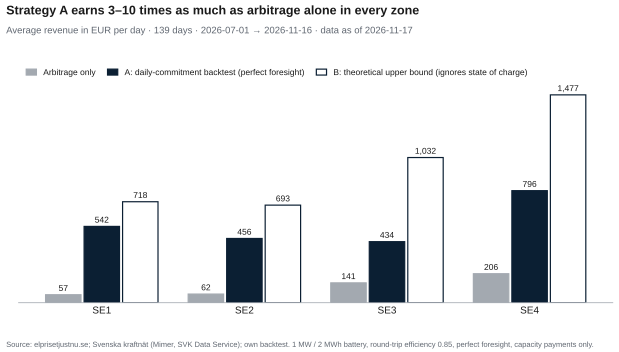

# Results

<!-- results:window:start -->
**139 days, 2026-07-01 → 2026-11-16, data as of 2026-11-17.** Averages in EUR per day for a 1 MW / 2 MWh battery.
<!-- results:window:end -->

Tables and charts on this page are generated from the warehouse marts by
[`scripts/make_results.py`](../scripts/make_results.py) with the queries in
[`sql/results/`](../sql/results/); no number in a table is typed by hand.

These are backtest results with perfect foresight, not expected revenue.

## Headline

<!-- results:summary:start -->
| Zone | Arbitrage only | Best reserve product (days best) | A: daily-commitment backtest (perfect foresight) | B: theoretical upper bound | Ceiling above A (B / A − 1) |
| --- | --- | --- | --- | --- | --- |
| SE1 | 56.7 | mFRR down, 458.7 (82 of 139) | 542.4 | 717.6 | +32 % |
| SE2 | 61.5 | FCR-N, 395.3 (108 of 139) | 456.4 | 693.3 | +52 % |
| SE3 | 141.2 | FCR-N, 395.3 (128 of 139) | 434.0 | 1,031.6 | +138 % |
| SE4 | 206.2 | mFRR up, 722.5 (95 of 139) | 796.3 | 1,476.8 | +85 % |
<!-- results:summary:end -->

<!-- results:coverage:start -->
SE1 mFRR up: 3,245 of 3,337 hours published (10 days with gaps). Unpublished hours count as 0 revenue.
<!-- results:coverage:end -->

## Method

1. **Data.** Spot prices for SE1-SE4 (elprisetjustnu.se, 15-minute), FCR-N / FCR-D up / FCR-D down capacity prices (Svenska kraftnät, Mimer) and mFRR capacity prices per zone (Svenska kraftnät, SVK Data Service), fetched into an S3 raw zone, loaded unchanged into Postgres and transformed with dbt (see the [README](../README.md)).
2. **Arbitrage only** (`fct_arbitrage_daily`): the best single charge/discharge cycle of the day on 15-minute prices. Charge for 2 hours at full power, then discharge for 2 hours, discharge after charging, same delivery day, at most one cycle; round-trip losses applied to the discharge revenue; idle if no cycle is profitable.
3. **Reserve products** (`fct_reserve_daily`): the capacity payment if the full battery power is offered in one product for every hour of the day.
4. **Strategy A** (`mart_strategy_daily`): each day, the best of the six single choices (arbitrage or one of five reserve products), on days where both spot and reserve data exist.
5. **Strategy B** (`mart_upper_bound_daily`): per 15-minute quarter, the best of reserve capacity, discharging (energy bought at the day's cheapest quarter) or idle.

## Battery assumptions

| Assumption | Value | Where | Source |
| --- | --- | --- | --- |
| Power | 1 MW | dbt var `battery_power_mw` | Illustrative size; results scale linearly with power |
| Energy | 2 MWh (2-hour battery) | dbt var `battery_energy_mwh` | Illustrative; a common duration for grid batteries |
| Round-trip efficiency | 0.85 | dbt var `round_trip_efficiency` | NREL / NLR Annual Technology Baseline 2025, utility-scale battery storage: "the 2025 ATB assumes a roundtrip efficiency of 85%" ([atb.nlr.gov](https://atb.nlr.gov/electricity/2025/utility-scale_battery_storage)) |

## Definitions

- **A: daily-commitment backtest (perfect foresight).** The battery commits to one strategy per day, chosen with full knowledge of that day's prices. A real operator would choose before the prices are known, so A is an upper estimate for a one-strategy-per-day operator.
- **B: theoretical upper bound.** Every quarter takes its best option independently. B ignores state of charge, so it widens with price volatility by construction: no real battery can execute it. The gap between A and B is therefore not money an optimiser can be expected to capture; how much a real, state-of-charge-constrained optimiser could capture is the Phase 2 question (optimiser C).
- **Ceiling above A:** B / A − 1.
- None of these figures is expected revenue.

## Caveats

- Capacity payments only; activation energy payments are not included.
- No state-of-charge or endurance rules for reserves, and no stacking of several products in one hour.
- Price-taker: the battery's bids never move a price.
- Perfect foresight: every price of the day is known in advance.
- FCR price formation is taken from published results and not independently verified.
- SE1 mFRR up: some hours are not published by the source (see the coverage note above). They count as 0 revenue (conservative). Most likely no capacity was procured in those hours; SvK's documentation does not confirm this.
- The last month in the window can be partial; the monthly table shows the number of days.
- The spring daylight-saving day (23 hours) is not yet in the data; how the FCR source labels it is unverified.

## First 99 days compared with the full window

The first published results covered 2026-07-01 to 2026-10-07. Rebuilding the lake from scratch reproduced them exactly; the table compares them with the full window.

<!-- results:comparison:start -->
| Zone | A, 99 days | A, 139 days | Change in A | B, 99 days | B, 139 days | Best reserve product (99 / 139 days) |
| --- | --- | --- | --- | --- | --- | --- |
| SE1 | 593.0 | 542.4 | -8.5 % | 772.3 | 717.6 | mFRR down / mFRR down |
| SE2 | 492.0 | 456.4 | -7.2 % | 737.8 | 693.3 | FCR-N / FCR-N |
| SE3 | 453.9 | 434.0 | -4.4 % | 949.7 | 1,031.6 | FCR-N / FCR-N |
| SE4 | 719.6 | 796.3 | +10.7 % | 1,432.1 | 1,476.8 | mFRR up / mFRR up |
<!-- results:comparison:end -->

## Over time

<!-- results:monthly:start -->
| Zone | Month | Days | Arbitrage only | A | B | Ceiling above A |
| --- | --- | --- | --- | --- | --- | --- |
| SE1 | 2026-07 | 31 | 22.0 | 601.5 | 653.6 | +9 % |
| SE1 | 2026-08 | 31 | 70.4 | 663.5 | 884.2 | +33 % |
| SE1 | 2026-09 | 30 | 87.9 | 554.7 | 851.3 | +53 % |
| SE1 | 2026-10 | 31 | 52.1 | 431.1 | 577.6 | +34 % |
| SE1 | 2026-11 | 16 | 48.2 | 385.5 | 539.3 | +40 % |
| SE2 | 2026-07 | 31 | 23.4 | 515.6 | 586.4 | +14 % |
| SE2 | 2026-08 | 31 | 73.2 | 569.6 | 847.9 | +49 % |
| SE2 | 2026-09 | 30 | 94.7 | 407.1 | 846.6 | +108 % |
| SE2 | 2026-10 | 31 | 59.0 | 382.1 | 568.6 | +49 % |
| SE2 | 2026-11 | 16 | 55.1 | 358.6 | 554.8 | +55 % |
| SE3 | 2026-07 | 31 | 103.1 | 451.5 | 846.4 | +87 % |
| SE3 | 2026-08 | 31 | 122.2 | 560.0 | 985.5 | +76 % |
| SE3 | 2026-09 | 30 | 158.1 | 357.8 | 1,032.7 | +189 % |
| SE3 | 2026-10 | 31 | 139.2 | 382.1 | 1,025.1 | +168 % |
| SE3 | 2026-11 | 16 | 224.5 | 399.8 | 1,490.4 | +273 % |
| SE4 | 2026-07 | 31 | 192.4 | 730.7 | 1,390.0 | +90 % |
| SE4 | 2026-08 | 31 | 165.5 | 628.3 | 1,217.0 | +94 % |
| SE4 | 2026-09 | 30 | 263.5 | 687.2 | 1,576.5 | +129 % |
| SE4 | 2026-10 | 31 | 202.2 | 1,079.5 | 1,663.8 | +54 % |
| SE4 | 2026-11 | 16 | 211.8 | 904.6 | 1,599.0 | +77 % |
<!-- results:monthly:end -->

## Which strategy wins

<!-- results:winners:start -->
| Zone | Arbitrage | FCR-N | FCR-D up | mFRR up | mFRR down |
| --- | --- | --- | --- | --- | --- |
| SE1 | 1 | 54 | 2 | 0 | 82 |
| SE2 | 2 | 108 | 2 | 1 | 26 |
| SE3 | 2 | 128 | 2 | 6 | 1 |
| SE4 | 3 | 38 | 2 | 95 | 1 |
<!-- results:winners:end -->

## How to reproduce

1. Backfill the raw zone (Airflow `ingest_daily`, or `airflow dags test ingest_daily <logical date>` per day) and check it with `python verify_backfill.py <start> <end>`.
2. `load_env`, then `python load_raw.py <start> <end>`.
3. `dbt build` inside `battery_dbt/` (expected: no errors; one warning lists the unpublished mFRR hours).
4. `pip install -r requirements-results.txt`, then
   `python scripts/make_results.py 2026-07-01 2026-11-16 --as-of 2026-11-17`.
   Running it twice on the same data changes no file.
